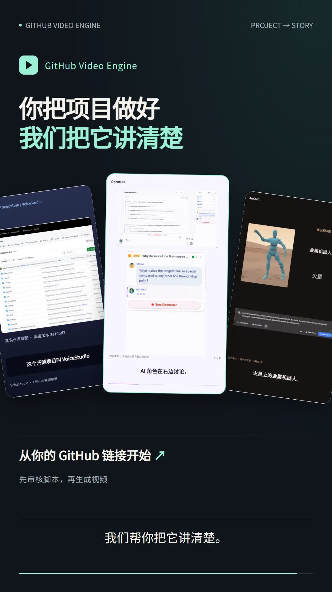
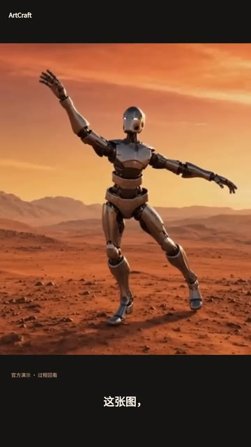
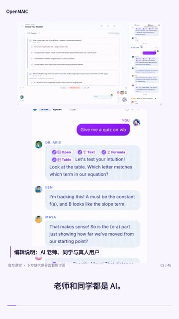

# GitHub Video Engine

[简体中文](README.zh-CN.md) · [English](README.md)

**Turn your GitHub repo into a short video people can understand and want to watch.**

<p align="center">
  <a href="docs/media/engine-flagship.mp4"></a>
</p>
<p align="center"><a href="docs/media/engine-flagship.mp4"><strong>▶ From GitHub repo to video · 57 seconds · Mandarin</strong></a></p>

Follow OpenMAIC from a repo link through script review to a finished video and editable project. [Production and review notes](docs/flagship-video/README.md)

Give Codex a repo link and tell it who you want to reach. Review the narration and storyboard, then render a vertical video with voiceover and captions. The editable project lets you revise the result.

[Watch the demos](#demos) · [Try it with your repo](#try-it-with-your-repo) · [Engineering docs](#engineering-docs)

## Demos

All four demos are vertical videos in Mandarin. Click a cover or an MP4 link to watch.

| 山海所知 | VoiceStudio |
| :---: | :---: |
| <a href="docs/media/worldknow-demo.mp4"></a> | <a href="docs/media/voicestudio-demo.mp4"></a> |
| **How did a giraffe reach Ming China?**<br>Follow the story on a map and see how time and perspective change what it shows. | **Same voice, different line.**<br>Hear official audio samples and see how reference audio and new text shape the result. |
| [Watch MP4 · 43 sec](docs/media/worldknow-demo.mp4) | [Watch MP4 · 41 sec](docs/media/voicestudio-demo.mp4) |

| ArtCraft | OpenMAIC |
| :---: | :---: |
| <a href="docs/media/artcraft-demo.mp4"></a> | <a href="docs/media/openmaic-b-demo.mp4"></a> |
| **Can you show AI a pose?**<br>See how a posed figure and a text prompt guide a robot render. | **What happens in a classroom with AI teachers and classmates?**<br>Watch a discussion and see how a topic or source document can become a lesson. |
| [Watch MP4 · 25 sec](docs/media/artcraft-demo.mp4) | [Watch MP4 · 46 sec](docs/media/openmaic-b-demo.mp4) |

The [70-second workflow demo](docs/media/engine-workflow.mp4) shows how to turn repo evidence into a script, revise it after feedback, and deliver an editable project.

## Try it with your repo

1. Open a configured GitHub Video Engine checkout in Codex. Start with the [setup and usage guide](docs/codex-user-path-v1.md).
2. Share the repo URL, audience, and publishing platform. You can also specify duration, style, and voice.
3. Review the complete narration and storyboard. Once approved, render the MP4 and export the editable project. Ask for revisions in the same chat.

Example prompt for Codex:

```text
Turn https://github.com/OWNER/REPO into a 45-second vertical video for
viewers who don't know the project. Open with a concrete example and
explain how it works. Show me the full narration and shot-by-shot
storyboard for review before rendering.
```

Codex researches the repo and plans the story. The engine records evidence, approvals, jobs, and render outputs. Built-in repo research is read-only. Local narration requires a configured voice runtime, model, and authorized reference audio. [Voice setup](docs/narration-voice-preference.md)

## Engineering docs

| Topic | Start here |
| --- | --- |
| Setup and workflow | [Codex guide](docs/codex-user-path-v1.md), [production workflow](docs/narrative-run-v1.md) |
| Fact review, revisions, and handoff | [Script fact review](docs/script-facts-v1.md), [revision workflow](docs/rsi-repair-v1.md), [portable projects](docs/long-preview-portability-v1.md) |
| Claude Code and API adapters | [Claude Code](docs/claude-code-user-path-v1.md), [bring your own API](docs/byo-api-author-v1.md). Entry points are implemented. End-to-end rendering with a live model remains unverified. |
| Rendering, architecture, and licensing | [Source clip adapter](docs/showcase-reel.md), [operator runbook](docs/operator-runbook.md), [architecture and licensing](docs/decisions.md) |

<details>
<summary>Local setup and checks</summary>

The documented baseline is Windows x64 with NTFS. Use Node.js 24.x, pnpm 11.25.0, and a filesystem with same-volume hard links. Rendering also requires local Chrome or Chromium, FFmpeg, and FFprobe.

```sh
pnpm install --frozen-lockfile
pnpm run doctor
pnpm run typecheck
pnpm test
```

Smoke and acceptance checks render fresh media and can take several minutes. See the [operator runbook](docs/operator-runbook.md) for CLI commands and environment variables.

</details>
